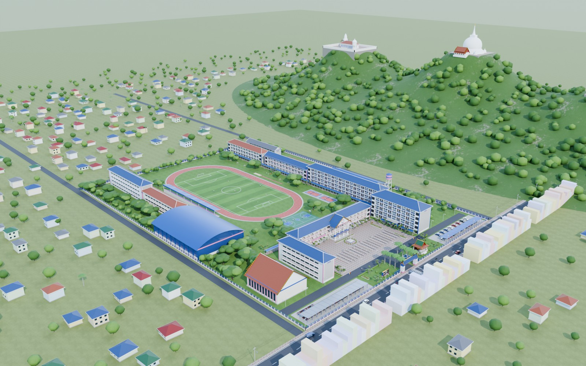
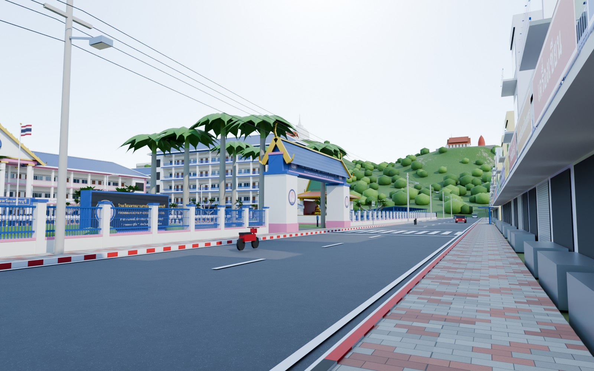
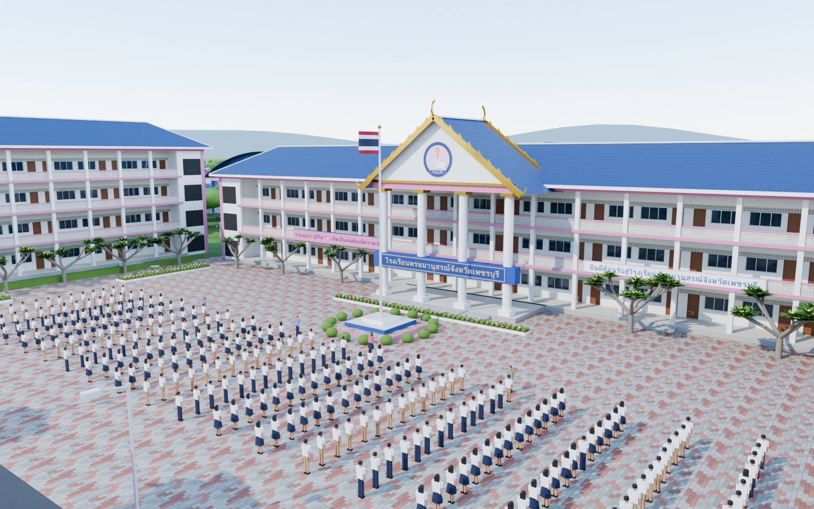
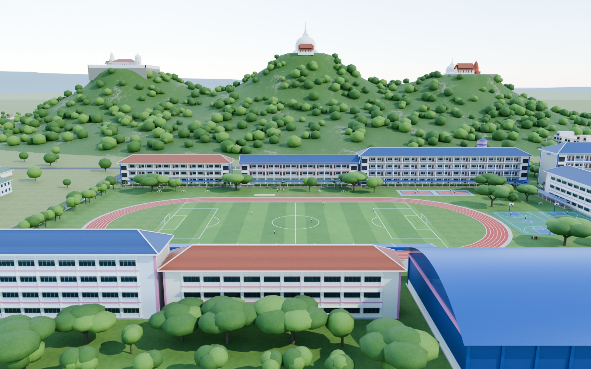
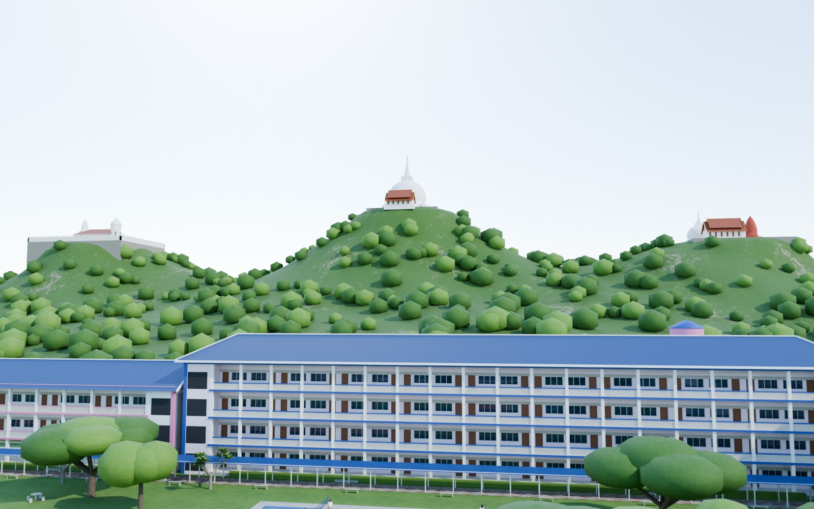
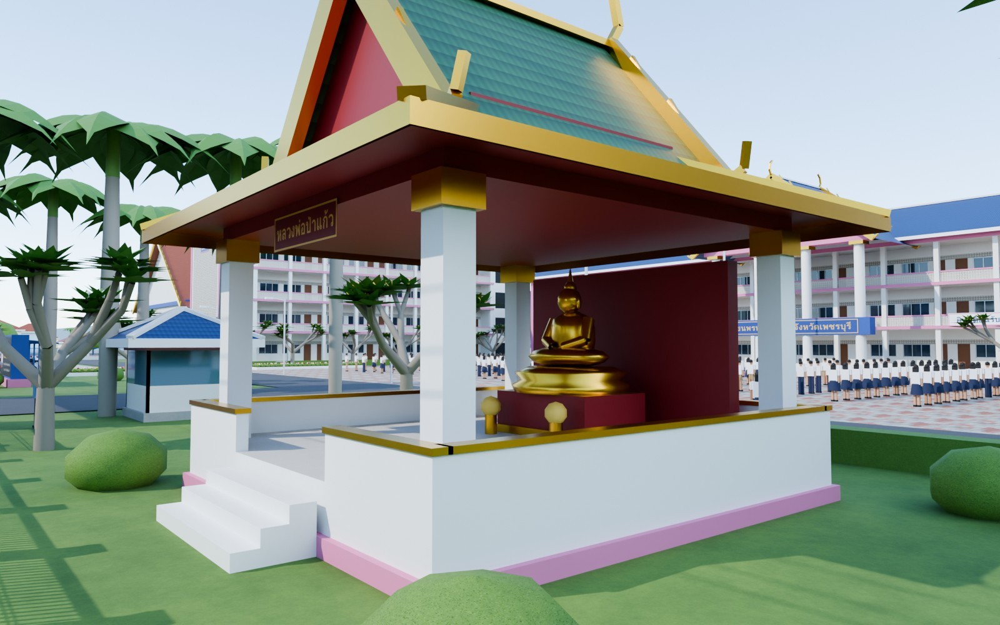
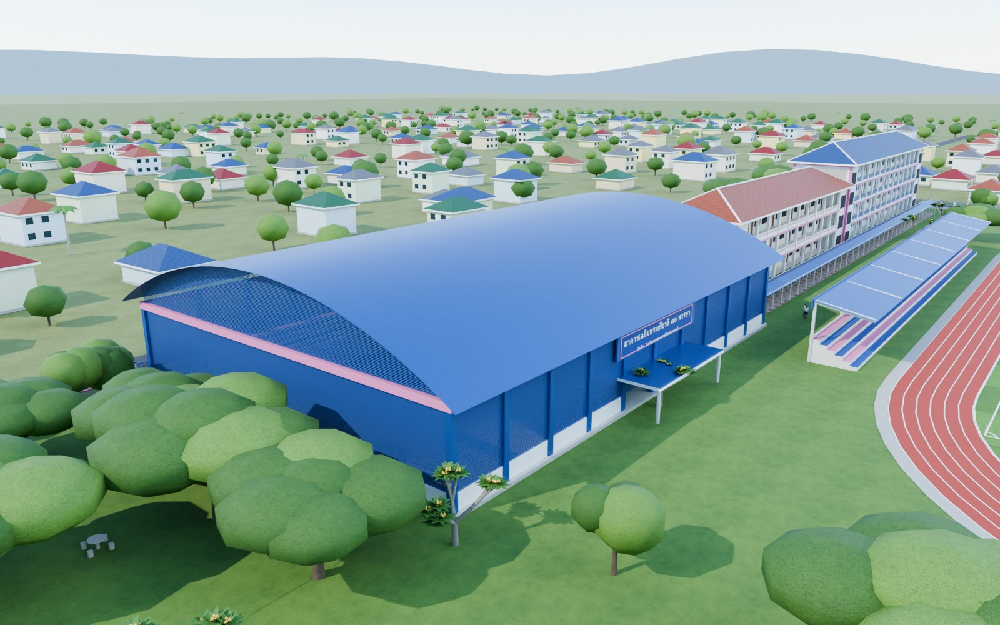
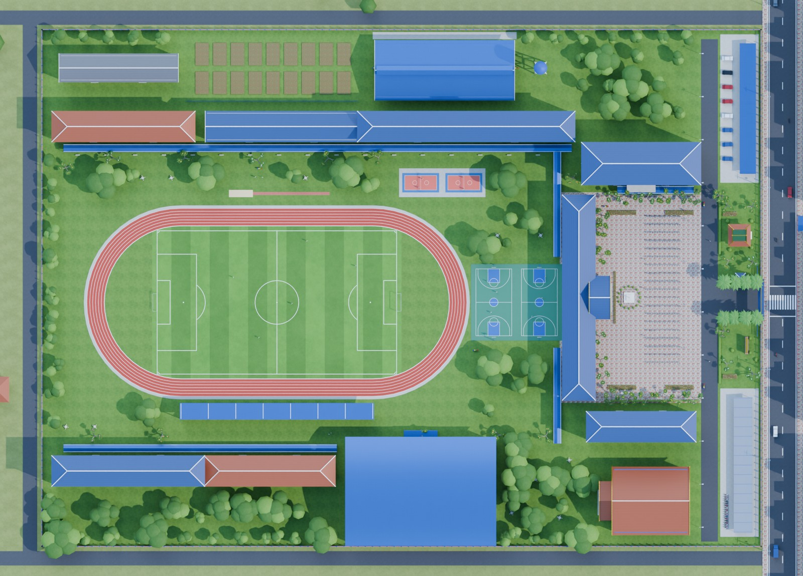

# โมเดล 3 มิติ โรงเรียนพรหมานุสรณ์จังหวัดเพชรบุรี

โมเดล 3 มิติทั้งโรงเรียน สร้างด้วย Blender 5.2 ผ่านสคริปต์ Python ทั้งหมด (procedural)
ไม่ได้ปั้นด้วยมือ จึงแก้ตำแหน่ง ขนาด สี หรือจำนวนชั้นของอาคารได้ที่โค้ด แล้วสร้างใหม่ทั้งฉากได้ในไม่กี่วินาที



| | |
|---|---|
|  |  |
|  |  |
|  |  |



## ไฟล์

| ไฟล์ | ใช้ทำอะไร |
|---|---|
| `output/phromanusorn.blend` | ไฟล์ Blender ฝังเท็กซ์เจอร์ไว้ในไฟล์แล้ว มีกล้อง 8 ตัว ไฟ และท้องฟ้าพร้อมเรนเดอร์ |
| `output/phromanusorn.glb` | glTF ฉบับเต็ม เปิดได้ในโปรแกรม 3D ทั่วไป และ Windows 3D Viewer |
| `output/phromanusorn_web.glb` | glTF บีบอัด (meshopt) ขนาด 8.8 MB สำหรับเว็บและมือถือ |
| `output/phromanusorn_lite.glb` | glTF ฉบับเบา ไม่ต้องถอดรหัส ไม่มีบ้านและต้นไม้รอบนอก |
| `output/phromanusorn.fbx` | FBX ฝังเท็กซ์เจอร์ สำหรับ Unity, Unreal, 3ds Max, Maya, SketchUp |
| `output/phromanusorn_obj.zip` | OBJ + MTL + เท็กซ์เจอร์ |
| `renders/*.jpg` | ภาพเรนเดอร์ Cycles 1600×1000 จากกล้องทั้ง 8 ตัว |
| `web/index.html` | หน้าเว็บหมุนดูโมเดล (three.js) ใช้ข้อมูลใน `web/data/` ที่สร้างด้วย `scripts/web_pack.py` และ `web/poster.jpg` (ภาพ `renders/01_Overview.jpg`) |

หน่วยในโมเดลเป็นเมตร แกน +Y ใน Blender ชี้ทิศเหนือ (ใน glTF/FBX เป็นแกน -Z)
จุดกึ่งกลางโรงเรียนอยู่ที่ (0, 0)

## สิ่งที่อยู่ในโมเดล

- **อาคารเรียน 9 หลัง** ตามข้อมูลว่าโรงเรียนมีอาคารเรียน 9 หลัง 70 ห้องเรียน ออกแบบตามอาคารเรียน คสล. มาตรฐาน สพฐ.
  ได้แก่ ระเบียงทางเดินด้านหนึ่ง ห้องเรียนกว้าง 2 ช่วงเสา (มีประตู 2 บาน กระดานดำ และผนังกั้นห้อง)
  หน้าต่างบานใหญ่และช่องแสง ผนังช่องลม บันไดที่หัวท้ายอาคาร และป้ายชื่อ "อาคาร 1–9"
  - อาคาร 1 อาคารอำนวยการ 3 ชั้น มีมุขหน้าจั่วทรงไทย ช่อฟ้า ใบระกา ตราโรงเรียน ป้ายชื่อโรงเรียน
    ป้าย "ยินดีต้อนรับ" และคติพจน์ "วายเมเถว ปุริโส"
  - อาคาร 3 เป็นแบบใต้ถุนโล่ง 3 ชั้น 18 ห้อง
  - อาคาร 9 สูง 5 ชั้น (ข้อมูล สพฐ. ระบุว่ามีอาคาร 5 ชั้นสร้างปี 2557) มีโถงกระจกชั้นล่าง
- **อาคารเฉลิมพระเกียรติ ๘๐ พรรษา (โรงยิม)** หลังคาโค้ง บานเกล็ด สนามบาสในร่ม และอัฒจันทร์
- **หอประชุม** หน้าจั่วทรงไทย **โรงอาหาร/อาคารอเนกประสงค์** มีโต๊ะ ม้านั่ง และซุ้มร้านค้า
- **ศาลาหลวงพ่อป่าแก้ว** (พระพุทธรูปประจำโรงเรียน) หลังคาซ้อนชั้นทรงไทย
- **เสาธง ธงชาติไทย และนักเรียนเข้าแถวตอนเช้า** ราว 270 คน (ชุดนักเรียนชาย-หญิง) พร้อมครู
- **สนามฟุตบอลพร้อมเส้นสนาม ลู่วิ่งยาง 6 ลู่ อัฒจันทร์ ประตูฟุตบอล หลุมกระโดดไกล**
- สนามบาส 2 สนาม สนามตะกร้อ 2 สนาม
- **ต้นลีลาวดี** (ต้นไม้ประจำโรงเรียน) ต้นจามจุรี ปาล์ม ไม้พุ่ม และแปลงดอกไม้
- ทางเดินมีหลังคา โต๊ะม้าหิน ถังขยะแยกประเภท แปลงเกษตร หอถังสูง
  โรงจอดรถจักรยานยนต์นักเรียน และที่จอดรถครู
- รั้วโรงเรียน ป้อมยาม **ซุ้มประตูพร้อมป้ายชื่อโรงเรียน** และป้ายหินแกรนิต
- **ถนนบันไดอิฐ** มีทางม้าลายหน้าโรงเรียน ขอบทางแดงขาว เสาไฟฟ้าและสายไฟ ป้ายเขตโรงเรียน
  ศาลาที่พักผู้โดยสาร รถสองแถว และตึกแถวฝั่งตรงข้าม (ร้านถ่ายเอกสาร เครื่องเขียน ขนมหม้อแกงเมืองเพชร ฯลฯ)
- **เขาวัง (พระนครคีรี)** ด้านเหนือของโรงเรียน มี 3 ยอด ได้แก่ พระธาตุจอมเพชร (เจดีย์ขาว) พระราชวัง
  (หอชัชวาลเวียงชัย และปราสาทยอดปรางค์) และวัดพระแก้ว (พระปรางค์แดง)
- บ้านเรือนรอบ ๆ และเทือกเขาไกลทางทิศตะวันตก

รวมทั้งฉากประมาณ 613,000 สามเหลี่ยม

## ข้อจำกัด

- **ผังและรูปทรงอาคารเป็นการจัดวางโดยประมาณ** ข้อมูลที่ใช้มาจากแหล่งสาธารณะ ได้แก่ ที่ตั้ง
  (278 ถนนบันไดอิฐ, 13.10408 N 99.93717 E) พื้นที่ราว 40 ไร่ 2 งาน จำนวนอาคาร
  สีประจำโรงเรียน (น้ำเงิน-ชมพู) ต้นไม้ประจำโรงเรียน และพระพุทธรูปประจำโรงเรียน
  ตอนสร้างเครื่องเข้าแผนที่ดาวเทียม/OpenStreetMap ไม่ได้ ตำแหน่ง ทิศ และขนาดอาคารแต่ละหลังจึงยังไม่ตรงกับของจริง
- ตราโรงเรียน (ช้างหมอบชูคบเพลิง) วาดขึ้นใหม่เป็นแบบจำลอง ไม่ใช่ไฟล์ตราทางการ
- เขาวังเป็นการจำลองรูปทรงคร่าว ๆ

ถ้ามีรูปถ่ายอาคารจริง ภาพหน้าจอจากแผนที่ หรือผังโรงเรียนที่วาดมือ ก็นำมาปรับตำแหน่ง
จำนวนชั้น สีหลังคา และรายละเอียดอื่นให้ตรงของจริงได้ (แก้ใน `scripts/campus.py`)

## สร้างใหม่ / แก้ไข

```bash
pip install bpy==5.2.3            # Blender แบบไลบรารี Python
python3 scripts/textures.py       # เท็กซ์เจอร์ + ป้ายภาษาไทย (ใช้ฟอนต์ Loma ของ TLWG)
python3 scripts/build.py          # สร้างฉาก -> output/
python3 scripts/render.py         # เรนเดอร์ภาพ -> renders/
python3 scripts/web_pack.py       # แปลง glb สำหรับหน้าเว็บ -> web/data/
# ไฟล์ _web.glb ต้องใช้ gltfpack (npm i -g gltfpack) หรือ npx ถ้าไม่มีจะข้ามขั้นนี้
# เปิดหน้าเว็บในเครื่อง: cp renders/01_Overview.jpg web/poster.jpg && python3 -m http.server -d web
```

| สคริปต์ | หน้าที่ |
|---|---|
| `scripts/campus.py` | ผังโรงเรียน: ตำแหน่งอาคาร ถนน สนาม ต้นไม้ คน รถ ตึกแถว เขาวัง |
| `scripts/buildings.py` | ตัวสร้างอาคาร: อาคารเรียน มุขอาคารอำนวยการ โรงยิม หอประชุม โรงอาหาร ศาลา ประตู รั้ว เสาธง ฯลฯ |
| `scripts/mb.py` | ตัวช่วยสร้าง mesh (กล่อง ทรงกลึง หลังคาปั้นหยา หลังคาจั่วทรงไทย หลังคาโค้ง) |
| `scripts/materials.py` | วัสดุทั้งหมด |
| `scripts/textures.py` | เท็กซ์เจอร์ (หญ้า กระเบื้อง ลู่วิ่ง ช่องลม) ป้ายภาษาไทย ธงชาติ ตราโรงเรียน |
| `scripts/scene_setup.py` | ท้องฟ้า แสงแดดยามเช้า กล้อง การตั้งค่า Cycles |

ตัวอย่างการแก้: อยากให้อาคาร 2 เป็น 4 ชั้น หลังคาสีน้ำเงิน ให้แก้บรรทัด `place_block(coll, "B2", ...)`
ใน `scripts/campus.py` เป็น `..., 4, ..., roof_mat="roof_blue"` แล้วรัน `build.py` ใหม่

## แหล่งข้อมูล

- วิกิพีเดีย: [โรงเรียนพรหมานุสรณ์จังหวัดเพชรบุรี](https://th.wikipedia.org/wiki/โรงเรียนพรหมานุสรณ์จังหวัดเพชรบุรี)
  และ [Prommanusorn Phetchaburi School](https://en.wikipedia.org/wiki/Prommanusorn_Phetchaburi_School)
- Wikidata: [Q16306831](https://www.wikidata.org/wiki/Q16306831) (พิกัด)
- [ข้อมูลพื้นฐานโรงเรียน (EMIS)](http://data.bopp-obec.info/emis/schooldata-view.php?Area_CODE=101710&School_ID=1076370247)
  และ [ระบบข้อมูลสินทรัพย์ สพฐ.](https://asset.bopp-obec.info/Home/BuildingBySchoolID?SchoolID=1076370247)
- [ประวัติโรงเรียน (m-culture)](http://www.m-culture.in.th/album/88321) และ [reg.pawano.net](https://reg.pawano.net/promma/info)
- เว็บไซต์โรงเรียน [promma.ac.th](http://promma.ac.th/mainpage)
